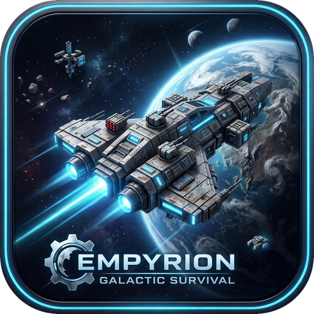

# Empyrion Scenario Editor

<p align="center">
  
</p>

[](https://github.com/Daflo-Empyrion/Scenario-Editor/releases/latest)
[](https://www.gnu.org/licenses/gpl-3.0.html)
[](https://github.com/Daflo-Empyrion/Scenario-Editor/releases/latest)

**[🇫🇷 Français](#français)** · **[🇬🇧 English](#english)** · *[Journal des versions / Changelog](CHANGELOG.md)*

---

## Français

Editeur graphique (PyQt6) pour la creation et la modification de scenarios
**Empyrion Galactic Survival** : blocs et objets (ECF), recettes, playfields,
missions PDA, economie des marchands, arbres technologiques, dialogues et
localisation — avec une suite de traduction complete (IA locale ou en ligne),
un module d'administration de serveur dedie, un **bilan avant lancement qui
test reellement le chargement de ton scenario par le moteur du jeu**, un
**assistant IA** qui propose des modifications sans jamais ecrire seul, et un
systeme de securite qui preserve tes scenarios d'origine.

Documentation complete : `wiki_app_fr.md` (ou `wiki_app_en.md`), consultables
aussi depuis le menu Aide de l'application.

### Fonctionnalites

#### Edition ECF (blocs et objets)
- Arbre de navigation par blocs, recherche, filtrage par propriete, **fiche
  d'info detaillee** par item (descriptif, fabrication, deblocage, export
  Markdown) avec edition inline
- Mode tableau automatique pour les structures repetitives (Child Items,
  LootGroups...)
- **Creation guidee de bloc/item** : choix Id+Name ou Name seul, proprietes
  issues du fichier lui-meme (valeurs suggerees en liste deroulante),
  proposition automatique du Template (recette de craft) associe
- **Selecteur d'items par catalogue** sur toutes les cles qui referencent un
  item (conteneurs, loot, recettes, marchands...) — catalogue quasi
  instantane, dedoublonne scenario > vanille
- **Transformation en masse** : multiplier/ajouter/fixer/plafonner/arrondir
  une propriete sur plusieurs blocs a la fois, avec revue editable
- Duplication avec reecriture automatique des references internes
- **Bibliotheque de blocs reutilisables** : exporte un bloc d'un scenario,
  re-inserable dans n'importe quel autre, avec recherche par nom
- **Fusions specialisees** : fusion fine ECF entre scenarios, fusion par noms
  (creatures, classes sans Id), fusion Sectors avec unicite globale des
  playfields et dependances, fusion GalaxyConfig avec renumerotation des
  sequences, fusion YAML **ligne a ligne** (diff fin cochenable, sous-cles
  absentes proposees et reactivables), fusion de dossiers avec apercu
  modifiable avant ecriture
- Comparaison de scenarios A/B, fichiers modifies en un coup d'oeil,
  **comparaison de scenarios avec fusion selective** (synchronisation d'un
  fichier vers une copie de travail, merge automatique des zones saines)
- **Comparateur de bundles Unity** (assets ajoutes/retires/types)

#### Missions PDA
- Editeur complet : chapitres, taches, actions, recompenses, activations
- Assistant de creation de mission en 3 etapes
- **Validation du PDA** basee sur le guide officiel, calibree sur le contenu
  reel (vanille, Reforged Eden 2, Atlantis) : erreurs et avertissements
  navigables par double-clic
- **Export de l'histoire en Markdown** : chapitres, taches et actions avec
  leurs textes traduits, pour relire/partager le recit hors de l'application

#### Traduction (le gros morceau)
- **Moteurs multiples au choix** :
  - **NLLB (IA, Meta)** — 100 % local, aucun texte ne quitte le poste,
    variantes 600M / 1.3B installables depuis l'application
  - **Argos** — 100 % local, leger, installe en un clic
  - **Groq (IA en ligne)** — tier gratuit permanent, compte et cle crees en
    3 clics via l'assistant, compteur de quota en direct
  - **Google Translate** — sans cle API
- **Traductions officielles du jeu en vert** : les textes identiques a la
  localisation Eleon (Localization.csv, PDA.csv, Dialogues.csv de la
  vanille) sont traduits avec les textes officiels et marques visuellement
- **Corpus de traduction partage, qui apprend** : 37 900 cles deja traduites
  (Localization, Dialogues, PDA) embarquees et reprises sans IA ; toute
  traduction validee est **archivee par cle**, donc jamais repayee sur un
  autre scenario. « Mettre a jour le corpus » remonte tes corrections en
  annoncant le bilan (cles nouvelles / cellules ajoutees / valeurs
  remplacees) et laisse une copie datee avant tout ecrasement
- **En-tetes abimes repares** (`Français`) : appariement corrige, colonnes
  jamais ecrites cassees, et un bouton « Reparer les en-tetes » sur les CSV
  d'origine russe
- **Memoires de traduction** : ce que tu valides est retenu (jamais deux
  fois le meme travail) ; memoire officielle consultee en repli
- **Glossaire terminologique** : impose tes traductions d'acronymes et de
  noms propres, auto-alimente par les cellules courtes validees
- **Revisions interruptibles** : controler 5 000 lignes se fait en plusieurs
  fois — quitte la revue a tout moment, tout est sauvegarde et propose a la
  reprise
- **Correcteur orthographe/grammaire Grammalecte** integre (cellule,
  colonne ou fichier entier)
- **Protection des structures** : balises BBCode, placeholders
  ({PlayerName}...), nombres et termes du glossaire ne sont jamais deformes
  par les moteurs
- Confidentialite maitrisee : les moteurs locaux n'envoient rien du tout ;
  la traduction en ligne est desactivable d'une case (voir `PRIVACY.md`)
- Prouve en production : traduction FR integrale d'un gros scénario
  (9 267 lignes de PDA + 13 660 lignes de dialogues, 100 %, controle
  d'integrite zero)

#### Assistant IA (integre a l'editeur)
- **Chat contextuel** sur le document ouvert (ECF, YAML, CSV, PDA) : palette
  d'appels, historique, arret en cours de reponse
- **Plusieurs fournisseurs OpenAI-compatibles** declares librement (URL de
  base suffit, cle facultative pour un moteur local) ; routeur qui bascule
  automatiquement en cas de panne, de quota ou de plafond
- **Gratuit d'abord** : les maillons gratuits tournent en boucle ; le payant
  n'est utilise que si tu le coches ET que le cout estime tient dans le
  plafond mensuel (plafond global et par fournisseur, compteur en dollars)
- **L'assistant n'ecrit jamais** : il rend un jeu de modifications (ChangeSet)
  revu ligne par ligne, coche, applique par les validateurs de chaque format ;
  un ChangeSet invalide n'est jamais applique
- **Garde-fous** : secrets masques avant tout envoi a un fournisseur distant,
  document non sauvegarde jamais touche par une proposition (pour qu'un
  Ctrl+Z ne melange pas une modification humaine et une application IA)
- **« Expliquer avec IA »** sur une valeur (ECF, YAML, CSV) : le contexte
  verifiable est rassemble d'abord (glossaire, valeur vanille, mediane du
  document), la question ne porte que sur des faits
- Reprise du format natif d'appel d'outils en texte (DeepSeek/DSML), avec
  l'invariant d'affichage : aucun balisage n'atteint l'ecran ni l'historique

#### Equilibrage assiste
- **Recettes de craft** (Templates) : puissance reelle des blocs/items en
  face du cout des ingredients, composition vanille respectee
- **Couts de deblocage** (UnlockCost de l'arbre technologique) : perimetre
  limite aux entrees reellement affichees, bande de cout par niveau
- **Reparation du glossaire** : tri terminologie/phrases, reference a la
  localisation officielle, propositions revues avant toute ecriture
- **Reintegration de playfields orphelins** : un dossier absent du
  Sectors.yaml n'est jamais charge — repose dans des systemes existants,
  sans toucher au GalaxyConfig
- **Import cible d'un scenario source** avec resolution recursive des
  dependances (Ref, recette, BlockGroup, LootGroup, icone)

#### Playfields et galaxie (YAML)
- Editeur structure a 8 onglets (ressources, POI, creatures, drones,
  zones de spawn, effets...) au lieu du texte brut
- **Carte 2D** : POI deplacables a la souris, points de depart, patrouilles,
  zoom et filtres
- **Inspecteur de POI** : statistiques de drones par POI et par faction
- **Carte de la galaxie en 3D** (Sectors.yaml) : camera orbitale a la souris
  (orbite, deplacement, zoom — passe sous et au-dessus du plan galactique),
  une couleur par classe spectrale d'etoile (O B A F G K M) avec legende,
  halo sur les systemes structurants (Gate, Anomalie, depart), etiquettes
  intelligentes sans empilement, recherche de systeme, et **deplacement des
  systemes a la souris** en vue de dessus avec coordonnees affichees en
  direct (ecriture exacte dans Sectors.yaml, annulable)

#### Economie des marchands
- Editeur dedie : prix, stocks, taux de rachat, par station et par faction
- Verification de coherence integree (menu Verification)
- **Codex** (menu Outils > Balance) : navigateur objets/blocs/jetons avec
  recherche et **colonne de cases** (jusqu'a 4 objets au comparateur), fiche
  detail (stats, recette directe ou aplatie aux materiaux de base, cout,
  marchands), **comparateur** a differences unilaterales, fiche marchand avec
  prix estimes, **opportunites de trade** entre marchands (creation de route
  en un clic), **lieux d'un marchand** retrouves en croisant les en-tetes de
  prefabs (`Traders <nom>`) avec les POI des playfields, **carnet de lieux et
  de routes** (destination, item, note, vu date, net marchand) et **matrice de
  degats** armes x materiaux (paliers empiriques par colonne) — export CSV de
  chaque vue, lecture seule, rien n'est ecrit dans le scenario

#### Equilibrage et prix marche
- **Equilibrage du scenario** : regles par propriete (MaxCount, CPUIn,
  HitPoints, Damage...) avec politiques conserver / vanille / plafond /
  pourcentage, apercu cochable avant ecriture
- **Prix marche par cout de fabrication** : chaque MarketPrice face au cout
  reel de sa recette (Templates.ecf, cascade, OutputCount), formule reglable
  (marge + % de fabrication sur le cout des matieres), statuts par objet (fabriquable, template
  de groupe, cousin de tier, prix/masse materiau, ancrage manuel, non
  vendable), filtres et selection en masse, prix entiers, backup central et
  re-scan automatique
- **Equilibrage par correlations** : chaque propriete (masse, points de vie,
  degats, boucliers, poussee des propulseurs) comparee a la mediane de SON
  groupe (famille x tier) — le design volontaire est preserve, seules les
  incoherences internes sont proposees, avec medians epinglees apres
  application (pas de ratchet)
- **Audit des marchands** : uniformisation des taux de vente/rachat par
  marchand face aux MarketPrice effectifs, rachats manquants, prix absents,
  monnaies (Credits:) jamais touchees, arbitrages inter-marchands avec
  clamp moteur

#### Administration de serveur dedie (EWA)
Connecte ton scenario a un serveur dedie equipe du mod
[EmpyrionWebAccess](https://github.com/juonja/empyrion_webaccess) :
- **Dashboard** : etat du serveur, duree de session, actions demarrer/arreter
- **Chat** : lecture du chat serveur et reponse directe
- **Joueurs** : liste en direct, details, kick/ban, credits, envoi d'items
- **Structures** : liste, touche/supprime, faction, warp
- **Restauration** : joueurs et playfields depuis les backups du serveur
- **Timetable** : taches planifiees du serveur
- **Console telnet** brute et **SystemConfig** editable
- **Deploiement SFTP miroir** : synchronise ton scenario vers le serveur
  avec invalidation des caches du jeu
- Securite : mots de passe jamais persistes sans ton consentement explicite,
  cles d'hote SSH epinglees, confirmation avant toute action destructive

#### Bilan avant lancement — le scenario est-il chargeable ?
Un bouton, une reponse : **le jeu va-t-il charger ton scenario ?**
- **Moteur du jeu embarque** : tous les .yaml du scenario sont parses avec
  le YamlDotNet reel d'Empyrion et tous les .ecf valides structurellement —
  les erreurs exactes que le jeu afficherait, ligne et colonne
- **Structure Sectors** : playfields en doublon entre systemes, systemes
  sans soleil, fichiers etrangers, playfields references mais absents
- **Valeurs ECF** : valeurs de type inattendu vs dictionnaire de formes
  construit depuis la vanille
- **Groupes d'entites** : references `Entities:/Names:` vs
  EGroupsConfig/EClassConfig
- **Hygiène des configs** : blocs ouverts et fermes sur la meme ligne,
  `HitPoints` sans `type: int` (valeur ignoree en silence), entrees de
  conteneur hors plage, type de bloc etranger au fichier (`IndexOutOfRange`
  puis crash), `UnlockLevel` au-dela du cap joueur
- **Ressources en tension** : la politique de regeneration des POI est
  controlee (un POI qui revient au lieu de se recuperer une fois rend les
  ressources infinies) — l'alerte nomme la passe a relancer
- **GalaxyConfig** : sequences Child StarRegion/Territory sans doublon ni
  trou (crash documente)
- **Caches .yaml.bin** : orphelins et copies a date conservee
- **Test de chargement REEL** (optionnel) : demarre ton serveur dedie sur
  le scenario installe dans une sauvegarde jetable, surveille le demarrage,
  puis s'arrete seul — le vrai moteur valide tout, erreurs remontees dans
  le bilan
- **Export CSV** des resultats

#### Verifications
- References, references croisees entre fichiers, blocs en attente (conflits
  d'Id), economie, jetons orphelins, validation PDA, controle des
  blueprints .epb (blocs inconnus du catalogue, vue 3D)
- **Centre de verification (F5)** : tout d'un coup, avec compteurs

#### Securite
- Travail sur **copie de travail** : tes scenarios d'origine restent intacts
- Fichier non modifie reecrit **a l'identique octet par octet** (BOM et fins
  de ligne preserves)
- Sauvegardes versionnees avant mise a jour, restauration avec backup de
  securite, enregistrement atomique, recuperation apres plantage,
  annulation globale
- **Sauvegardes automatiques** (Outils > Fichiers) : liste par type, date et
  taille, restauration vers le fichier de ton choix (l'actuel est sauvegarde
  avant remplacement) et menage des plus anciennes, volume annonce avant
  suppression

#### Et aussi
- 13 themes visuels dont les themes Relief (nuit et clair), interface
  Fluent optionnelle
- Tutoriels integres pas-a-pas et wikis bilingues FR/EN consultables dans
  l'application
- Protocole de test manuel integre (260 cas FR/EN, commandes copiables)
- Bouton "Signaler" (rapport de bug pre-rempli vers GitHub Issues)
- Verification automatique de nouvelle version au demarrage
- Historique detaille des versions dans [`CHANGELOG.md`](CHANGELOG.md) — il
  alimente automatiquement les notes de release
- Outils en ligne de commande (`EmpyrionEditorCLI.exe`) pour les memes
  operations en scripts

### Installation

1. **Installeur Windows** (recommande) : telecharge
   `Setup-EmpyrionScenarioEditor-vX.X.X.exe` depuis la page
   [Releases](https://github.com/Daflo-Empyrion/Scenario-Editor/releases/latest)
   — installeur autonome, aucune dependance ni Python requis
2. **Depuis les sources** (pour developper) :
   ```bash
   python -m venv venv
   venv\Scripts\activate      # Windows
   pip install -r requirements.txt
   python run_gui.py
   ```

Fonctionne avec la vanille et les scenarios personnalises (Reforged Eden 2,
Atlantis...).

### Construire l'installeur

Voir [`BUILD.md`](BUILD.md) : PyInstaller + Inno Setup en local, ou
construction automatisee par GitHub Actions a chaque tag pousse.

### A propos des avertissements antivirus

Windows SmartScreen ou ton antivirus peuvent signaler l'installeur au
premier lancement — faux positif connu, courant sur les executables Python
non signes numeriquement. Le code source est integralement disponible dans
ce depot (voir `BUILD.md` pour le detail).

### Politique de signature de code / Code Signing Policy

Signature de code gratuite fournie par SignPath.io, certificat de la
Fondation SignPath (candidature en cours).
*Free code signing provided by SignPath.io, certificate by SignPath
Foundation (application pending).*

- **Committers, reviewers et approvers** : [Daflo](https://github.com/Daflo-Empyrion)
  (mainteneur unique de ce projet a ce jour)
- **Politique de confidentialite / Privacy policy** : voir [`PRIVACY.md`](PRIVACY.md)
  pour le detail exact de ce qui est envoye sur le reseau, quand, et comment
  le desactiver. En resume : tout est local, sauf la traduction en ligne que
  tu choisis explicitement d'activer.

### Signaler un bug ou proposer une amelioration

Le bouton "Signaler" integre a l'application (barre d'outils superieure)
ouvre un formulaire pre-rempli vers les
[Issues GitHub](https://github.com/Daflo-Empyrion/Scenario-Editor/issues) —
ou depose-en une directement.

### Licence

Ce projet est distribue sous licence **GNU General Public License v3.0**
(GPLv3) — voir le fichier [`LICENSE`](LICENSE) pour le texte complet.

En resume : tu es libre d'utiliser, etudier, modifier et redistribuer ce
logiciel, a condition que toute version modifiee ou derivee reste elle
aussi sous licence GPLv3, avec le code source disponible. Plus d'informations
sur [gnu.org/licenses](https://www.gnu.org/licenses/gpl-3.0.html).

---

## English

Graphical editor (PyQt6) to create and modify **Empyrion Galactic Survival**
scenarios: blocks and items (ECF), recipes, playfields, PDA missions, trader
economy, tech trees, dialogues and localisation — with a complete translation
suite (local or online AI), a dedicated server administration module, a
**pre-launch check that actually tests your scenario against the game engine
itself**, an **AI assistant** that only proposes changes (it never writes on
its own), and a safety system that preserves your original scenarios.

Full documentation: `wiki_app_en.md` (or `wiki_app_fr.md`), also available
from the application's Help menu.

### Features

#### ECF editing (blocks and items)
- Block navigation tree, search, per-property filtering, **detailed info card**
  per item (description, crafting, unlock, Markdown export) with inline editing
- Automatic table mode for repetitive structures (Child Items, LootGroups...)
- **Guided block/item creation**: Id+Name or Name only, properties taken from
  the file itself (suggested values in a drop-down), automatic proposal of the
  matching Template (crafting recipe)
- **Item picker from a catalogue** on every key that references an item
  (containers, loot, recipes, traders...) — near-instant catalogue,
  de-duplicated scenario > vanilla
- **Bulk transformation**: multiply/offset/set/clamp/round a property across
  many blocks at once, with an editable review
- Duplication with automatic rewriting of internal references
- **Reusable block library**: export a block from one scenario, insert it into
  any other, with search by name
- **Specialised merges**: fine-grained ECF merge between scenarios, merge by
  name (creatures, classes without Id), Sectors merge with global playfield
  uniqueness and dependencies, GalaxyConfig merge with sequence
  renumbering, **line-by-line** YAML merge (checkable fine diff, missing
  sub-keys proposed and re-enablable), folder merge with an editable preview
  before writing
- Scenario A/B comparison, modified files at a glance, **scenario comparison
  with selective merge** (sync one file into a working copy, automatic merge of
  healthy areas)
- **Unity bundle comparator** (added/removed assets and types)

#### PDA missions
- Complete editor: chapters, tasks, actions, rewards, activations
- 3-step mission creation wizard
- **PDA validation** based on the official guide, calibrated on real content
  (vanilla, Reforged Eden 2, Atlantis): errors and warnings navigable by
  double-click
- **Story export to Markdown**: chapters, tasks and actions with their
  translated texts, to review/share the narrative outside the application

#### Translation (the big piece)
- **Multiple engines to choose from**:
  - **NLLB (Meta AI)** — 100 % local, no text ever leaves the machine,
    600M / 1.3B variants installable from the application
  - **Argos** — 100 % local, lightweight, one-click install
  - **Groq (online AI)** — permanent free tier, account and key created in
    3 clicks through the assistant, live quota counter
  - **Google Translate** — no API key needed
- **Official game translations in green**: strings identical to Eleon's
  localisation (vanilla Localization.csv, PDA.csv, Dialogues.csv) are
  translated with the official texts and visually marked
- **Shared translation corpus that learns**: 37,900 already-translated keys
  (Localization, Dialogues, PDA) embedded in the app and reused without AI;
  every validated translation is **archived by key**, so it is never paid for
  again on another scenario. "Update the corpus" pushes your corrections back
  while announcing the tally (new keys / added cells / replaced values) and
  leaves a dated copy before any overwrite
- **Damaged headers repaired** (`Français`): matching fixed, columns never
  written broken, plus a "Repair headers" button for CSV files of Russian
  origin
- **Translation memories**: what you validate is remembered (never the same
  work twice); official memory consulted as a fallback
- **Terminology glossary**: enforce your translations of acronyms and proper
  nouns, self-fed by short validated cells
- **Interruptible reviews**: reviewing 5,000 lines happens over several
  sessions — leave at any time, everything is saved and offered on resume
- **Grammalecte spelling/grammar checker** built in (cell, column or whole
  file)
- **Structure protection**: BBCode tags, placeholders ({PlayerName}...),
  numbers and glossary terms are never mangled by the engines
- Controlled privacy: local engines send nothing at all; online translation
  can be switched off in one checkbox (see `PRIVACY.md`)
- Proven in production: full French translation of a large scenario
  (9,267 PDA lines + 13,660 dialogue lines, 100 %, zero integrity error)

#### AI assistant (built into the editor)
- **Contextual chat** on the open document (ECF, YAML, CSV, PDA): call
  palette, history, stop mid-answer
- **Several OpenAI-compatible providers** freely declared (base URL is enough,
  optional key for a local engine); a router that automatically switches on
  failure, quota or cap
- **Free first**: free endpoints are rotated in a loop; paid ones are only used
  if you tick them AND the estimated cost fits the monthly cap (global and
  per-provider caps, counter in dollars)
- **The assistant never writes**: it returns a set of changes (ChangeSet)
  reviewed line by line, ticked, applied by each format's validators; an
  invalid ChangeSet is never applied
- **Guard-rails**: secrets masked before any send to a remote provider,
  unsaved documents never touched by a proposal (so a Ctrl+Z cannot mix a
  human edit and an AI application)
- **"Explain with AI"** on a value (ECF, YAML, CSV): verifiable context is
  gathered first (glossary, vanilla value, document median), the question only
  concerns facts
- Native tool-call format recovered from text (DeepSeek/DSML), with the
  display invariant: no markup ever reaches the screen or the history

#### Assisted balancing
- **Crafting recipes** (Templates): real power of blocks/items against the
  cost of ingredients, vanilla composition respected
- **Unlock costs** (tech tree UnlockCost): scope limited to entries actually
  displayed, cost band per level
- **Glossary repair**: terminology/sentence sorting, reference to the official
  localisation, proposals reviewed before any write
- **Reintegration of orphan playfields**: a folder missing from Sectors.yaml
  is never loaded — place it back into existing systems without touching
  GalaxyConfig
- **Targeted import of a source scenario** with recursive dependency
  resolution (Ref, recipe, BlockGroup, LootGroup, icon)

#### Playfields and galaxy (YAML)
- Structured editor with 8 tabs (resources, POIs, creatures, drones, spawn
  zones, effects...) instead of raw text
- **2D map**: POIs draggable with the mouse, start points, patrols, zoom and
  filters
- **POI inspector**: drone statistics per POI and per faction
- **3D galaxy map** (Sectors.yaml): orbital camera with the mouse (orbit, pan,
  zoom — below and above the galactic plane), one colour per stellar class
  (O B A F G K M) with legend, halo on structuring systems (Gate, Anomaly,
  start), smart labels without overlap, system search, and **moving systems
  with the mouse** in top view with live coordinates (exact write into
  Sectors.yaml, undoable)

#### Trader economy
- Dedicated editor: prices, stocks, buy-back rates, per station and per faction
- Integrated consistency check (Verification menu)
- **Codex** (Tools > Balance menu): object/block/token browser with search and
  a **checkbox column** (up to 4 objects in the comparator), detail card
  (stats, direct or flattened recipe down to base materials, cost, traders),
  **comparator** with one-sided differences, trader card with estimated prices,
  **trade opportunities** between traders (one-click route creation), **a
  trader's locations** recovered by crossing prefab headers (`Traders <name>`)
  with playfield POIs, **place and route logbook** (destination, item, note,
  seen/dated, trader margin) and **damage matrix** weapons x materials
  (empirical tiers per column) — CSV export of every view, read-only, nothing
  is written into the scenario

#### Balancing and market prices
- **Scenario balancing**: rules per property (MaxCount, CPUIn, HitPoints,
  Damage...) with keep / vanilla / cap / percentage policies, checkable
  preview before writing
- **Market prices by crafting cost**: each MarketPrice against the real cost of
  its recipe (Templates.ecf, cascade, OutputCount), adjustable formula (margin
  + % of crafting on material cost), per-object statuses (craftable, group
  template, tier cousin, material price/mass, manual anchor, not sellable),
  filters and bulk selection, integer prices, central backup and automatic
  re-scan
- **Balancing by correlation**: each property (mass, hit points, damage,
  shields, thruster push) compared to the median of ITS group (family x tier) —
  deliberate design is preserved, only internal inconsistencies are proposed,
  with medians pinned after application (no ratchet)
- **Trader audit**: sales/buy-back rate standardisation per trader against
  effective MarketPrices, missing buy-backs, absent prices, currencies
  (Credits:) never touched, inter-trader arbitrage with engine clamp

#### Dedicated server administration (EWA)
Connect your scenario to a dedicated server running the
[EmpyrionWebAccess](https://github.com/juonja/empyrion_webaccess) mod:
- **Dashboard**: server state, session duration, start/stop actions
- **Chat**: read the server chat and answer directly
- **Players**: live list, details, kick/ban, credits, item delivery
- **Structures**: list, touch/delete, faction, warp
- **Restore**: players and playfields from the server backups
- **Timetable**: server scheduled tasks
- Raw **telnet console** and editable **SystemConfig**
- **Mirror SFTP deployment**: synchronises your scenario to the server with
  game cache invalidation
- Security: passwords never persisted without your explicit consent, SSH host
  keys pinned, confirmation before any destructive action

#### Pre-launch check — will the game load your scenario?
One button, one answer: **is the game going to load your scenario?**
- **Game engine embedded**: every scenario .yaml is parsed with Empyrion's real
  YamlDotNet and every .ecf is structurally validated — the exact errors the
  game would display, line and column
- **Sectors structure**: playfields duplicated across systems, systems without
  a sun, foreign files, referenced but missing playfields
- **ECF values**: values of unexpected type against a shape dictionary built
  from the vanilla files
- **Entity groups**: `Entities:/Names:` references against
  EGroupsConfig/EClassConfig
- **Config hygiene**: blocks opened and closed on the same line, `HitPoints`
  without `type: int` (silently ignored value), container entries past the
  index limit, a block type foreign to its file (`IndexOutOfRange` then
  crash), `UnlockLevel` beyond the player cap
- **Resource tension**: the POI regeneration policy is checked (a POI that
  comes back instead of being salvaged once makes resources infinite) — the
  alert names the pass to re-run
- **GalaxyConfig**: Child StarRegion/Territory sequences with no duplicate and
  no hole (documented crash)
- **`.yaml.bin` caches**: orphans and stale copies
- **REAL load test** (optional): starts your dedicated server on the scenario
  installed in a throwaway backup, watches startup, then stops by itself — the
  real engine validates everything, errors reported in the check
- **CSV export** of the results

#### Verifications
- References, cross-file references, blocks waiting (Id conflicts), economy,
  orphan tokens, PDA validation, .epb blueprint checks (blocks unknown to the
  catalogue, 3D view)
- **Verification centre (F5)**: everything at once, with counters

#### Safety
- Work on a **working copy**: your original scenarios stay untouched
- An unmodified file is rewritten **byte-for-byte identical** (BOM and line
  endings preserved)
- Versioned backups before updates, restore with a safety backup, atomic save,
  crash recovery, global undo
- **Automatic backups** (Tools > Files): list by type, date and size, restore
  to the file of your choice (the current one is backed up before replacement)
  and clean-up of the oldest, with the volume announced before deletion

#### And more
- 13 visual themes including the Relief ones (dark and light), optional
  Fluent interface
- Built-in step-by-step tutorials and bilingual FR/EN wikis readable inside the
  application
- Built-in manual test protocol (260 FR/EN cases, copyable commands)
- "Report" button (pre-filled bug report to GitHub Issues)
- Automatic new-version check at startup
- Full version history in [`CHANGELOG.md`](CHANGELOG.md) — it feeds the release
  notes automatically
- Command-line tools (`EmpyrionEditorCLI.exe`) for the same operations in
  scripts

### Installation

1. **Windows installer** (recommended): download
   `Setup-EmpyrionScenarioEditor-vX.X.X.exe` from the
   [Releases](https://github.com/Daflo-Empyrion/Scenario-Editor/releases/latest)
   page — standalone installer, no dependencies or Python required
2. **From source** (for development):
   ```bash
   python -m venv venv
   venv\Scripts\activate      # Windows
   pip install -r requirements.txt
   python run_gui.py
   ```

Works with vanilla and custom scenarios (Reforged Eden 2, Atlantis...).

### Building the installer

See [`BUILD.md`](BUILD.md): PyInstaller + Inno Setup locally, or automated
build by GitHub Actions on every pushed tag.

### About antivirus warnings

Windows SmartScreen or your antivirus may flag the installer on first launch —
a known false positive, common on Python executables without code signing. The
full source code is available in this repository (see `BUILD.md` for details).

### Code signing policy

Free code signing provided by SignPath.io, certificate by SignPath Foundation
(application pending).
*Signature de code gratuite fournie par SignPath.io, certificat de la
Fondation SignPath (candidature en cours).*

- **Committers, reviewers and approvers**:
  [Daflo](https://github.com/Daflo-Empyrion) (sole maintainer of this project
  to date)
- **Privacy policy**: see [`PRIVACY.md`](PRIVACY.md) for the exact detail of
  what is sent over the network, when, and how to disable it. In short:
  everything is local, except online translation which you explicitly choose to
  enable.

### Report a bug or suggest an improvement

The "Report" button built into the application (top toolbar) opens a
pre-filled form to [GitHub Issues](https://github.com/Daflo-Empyrion/Scenario-Editor/issues)
— or file one directly there.

### License

This project is distributed under the **GNU General Public License v3.0**
(GPLv3) — see the [`LICENSE`](LICENSE) file for the full text.

In short: you are free to use, study, modify and redistribute this software, as
long as any modified or derived version also stays under GPLv3, with the source
code available. More information on
[gnu.org/licenses](https://www.gnu.org/licenses/gpl-3.0.html).

Copyright (C) 2026 Daflo
